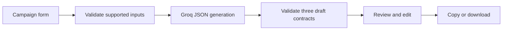

# PitchCraft AI — Project and Development Documentation

**IIT Patna Generative AI Capstone**

**Prepared for:** The owner of `aditagarwal07/ai-cold-email-generator`

**Repository:** https://github.com/aditagarwal07/ai-cold-email-generator

**Finalization branch:** `main`

**Entry point:** `app.py`

**Document status:** Notion-ready Markdown; not yet published to Notion.

## Overview and motivation

PitchCraft AI helps users draft concise, relevant cold emails and sales pitches. The
problem is not simply producing more words: it is explaining an offer clearly without
inventing information about a prospect. The application makes the campaign brief
explicit and keeps the user in control of the final wording.

The finalization returns to the original V1's single-form interface. V2 remains on
`capstone-v2`; no V2 source is merged or copied into `main`. The earlier V1 can be
inspected at commit `6458782a8b7735f13cb292841c001e96c27926ae`.

## Objectives and target audience

- Generate three distinct approaches from a supported campaign brief.
- Make personalization depend on supplied facts rather than invented research.
- Let freelancers, founders, small business teams and students review/edit/export.
- Provide understandable configuration and service-failure messages.
- Keep deployment and maintenance manageable for a beginner.

Success is demonstrated by a real generation plus successful review/export—not merely
an open port, an API key being present, or passing mocked tests.

## Technology stack

| Technology | Actual role | Evidence/limit |
|---|---|---|
| Python | Input/output checks and application logic | Local execution/tests |
| Streamlit | Form, output tabs, session state and downloads | Local UI; Cloud deployment pending verification |
| Official Groq SDK | Generative AI JSON request | Code and mocked HTTP tests; real account call pending |
| GitHub | Source history and reviewable changes | Repository exists; finalized main publication approved, see commit history |
| Make.com | Legacy delivery integration | Disabled; not counted as functional integration |
| Notion | Intended project documentation destination | This document prepared; page not yet published |

Default model: `llama-3.3-70b-versatile`, configurable through `GROQ_MODEL`. Credentials
come from Streamlit Secrets or environment variables. No secret belongs in source.
The repository has two direct dependencies: Streamlit and Groq; indirect SDK/framework
dependencies are installed by pip.

## Architecture

`app.py` owns the recognizable form and review interface. `pitchcraft.py` handles
configuration, campaign validation, prompt creation, AI requests, response validation
and text export. Tests are separate. There is no database, scheduler, browser scraping,
contact enrichment or email-sending path.

## Application workflow

1. Enter sender name/company, offer, differentiator, audience, pain point and objective.
2. Optionally enter recipient identity and facts with a supporting source/context.
3. Select tone and length; submit **Generate 3 drafts**.
4. Required and oversized inputs are rejected before an API request.
5. Review benefit-led, problem-aware and permission-first outputs.
6. Edit subject/body, check factual claims, choose a draft and copy/download the text.

Inputs inside the form take effect on submission. The displayed output explicitly
belongs to the last successful campaign. A failed/invalid replacement retains older
text for review but blocks exports until a successful generation.

## Prompt design and factual safeguards

The system message establishes truthful outreach, distinct strategies, output fields,
word limits and signature rules. Campaign details are a separate JSON user message
and are treated as untrusted data rather than instructions. Recipient pain points
are phrased conditionally. Missing recipient facts lead to neutral wording.

The prompt prohibits invented statistics, results, achievements, relationships,
research, prior contact, engagement and guarantees. Response checks require exactly
three strategy labels, nonempty fields, one-line subjects, consistent CTA/body, bounded
length, sufficiently different bodies and no new unsupported numbers.

These checks do not independently establish truth or prevent every possible model
hallucination. The user's review remains necessary, particularly after manual editing.

## Development process

1. Built the original Streamlit/Gemini/Make.com prototype.
2. Explored V2 separately and encountered reported Gemini availability failures.
3. Chose to finalize V1 rather than create another large application.
4. Audited `main` and documented exposed webhook/security and validation weaknesses.
5. Preserved the single form and wrote a small, fresh helper for the required checks.
6. Selected one Groq API path, considering the reported outages and existing Cloud key.
7. Disabled unverified sending; added edited text exports and safe errors.
8. Prepared automated/browser QA and this submission package.

Implementation was AI-assisted and should be described honestly. This document does
not imply that every line was written manually by the student.

## Challenges and solutions

| Challenge | Response | Remaining limit |
|---|---|---|
| API service failures | Simple configurable model, timeout, at most one SDK retry, safe errors | Application code cannot restore provider capacity/quota |
| Exposed webhook | Remove active value, disable sending, require owner revocation/rotation | Old URL still exists in history |
| Unsupported personalization | Separate facts, conditional pain points, constraints and review | No independent fact-checker |
| Free-form output inconsistency | JSON mode and explicit validation | Invalid outputs are rejected, not silently repaired |
| Beginner maintenance burden | Two source files and one provider | Future features intentionally deferred |
| Stale results | Last-successful-campaign label and blocked failed replacements | Unsubmitted form edits do not trigger generation |

## Testing methodology

Unit tests cover fields, prompts, JSON structure, strategy/length/CTA checks, numbers,
configuration, exports and provider errors. A real Groq SDK client is exercised with
mocked HTTP transport, including recovery and exhaustion of bounded retries. Streamlit
AppTest covers imports, forms, edit state, missing keys, older drafts and disabled sends.
Browser QA checks clipboard/download behavior using explicitly mocked responses.

The authoritative results and screenshot provenance are recorded in
`06_QA_and_Evidence.md`. Mocked tests do not prove live API access or deployed behavior.

## Security and privacy

- Real secrets files and local environments are ignored by Git.
- API keys are never included in request prompts, output or diagnostic logs.
- Errors log only class, status, category and a support reference; raw exceptions are suppressed.
- User content goes to Groq on generation; avoid confidential or sensitive data.
- Drafts use per-session state; there is no shared content cache or application database.
- No email is sent automatically or by a delivery button in this version.
- The legacy webhook is potentially compromised; revocation/rotation is an owner task.
- Public API usage needs provider quota monitoring; no global abuse protection is claimed.

## Screenshots and presentation evidence

Capture the branded campaign form, realistic nonconfidential input, all three live
strategies, one edited draft and its text download. Hide secrets/settings and private
recipient information. Any local QA screenshots supplied with this package use mocked
responses and must remain labeled as such. Replace them with actual live evidence before
claiming a working AI demonstration.

## Deployment details

Repository: `aditagarwal07/ai-cold-email-generator`; branch: **main**; entry point:
**app.py**; recommended Python: **3.12**. The original public URL is:
https://ai-cold-email-generator-lya8dhtlbwjr9e96frxtgs.streamlit.app/

Do not delete the existing app. After explicit approval, publish the reviewed main
changes, confirm these Cloud settings, retain/add the Groq key securely in this app's
Secrets, install dependencies and verify a real campaign. Local source watching can
be enabled with `--server.fileWatcherType auto`; production watching is disabled.

Current public behavior could not be verified from this workspace. No live API request
is claimed, because no credential is present here. Record actual runtime, test time,
public-access check and successful generation after approval.

## Capstone compliance and next steps

The supplied summary requires an AI web app, public deployment, a one-page idea,
3–5-minute narrated video, Notion documentation, four posts and tools from two eligible
categories. Official category definitions were not found. Streamlit and Groq have
real code roles but must not be declared eligible categories without the rubric.
Make.com is disabled and receives no category credit. See the submission checklist
and Make/tool-category plan for the precise outstanding evidence.

Publish this document to Notion and add the real page URL, real demo link, four post
links and live-test evidence to the checklist. No publication has been performed by
creating this Markdown file.
