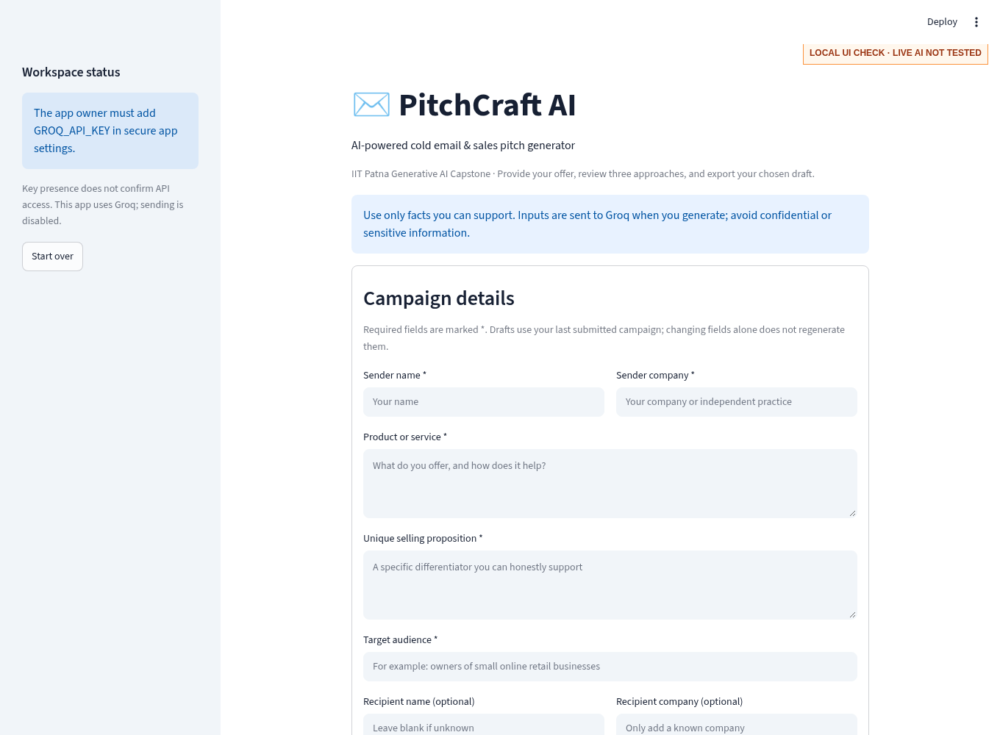
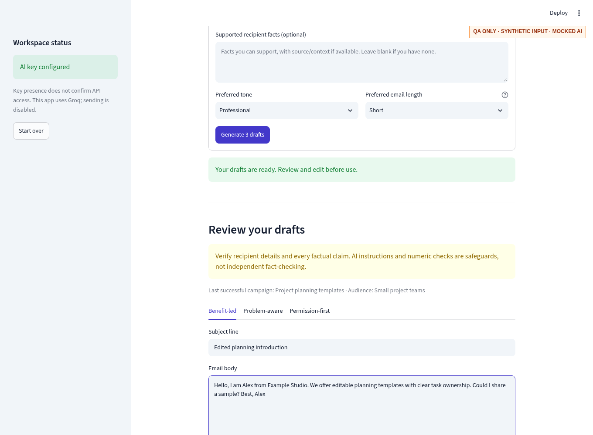
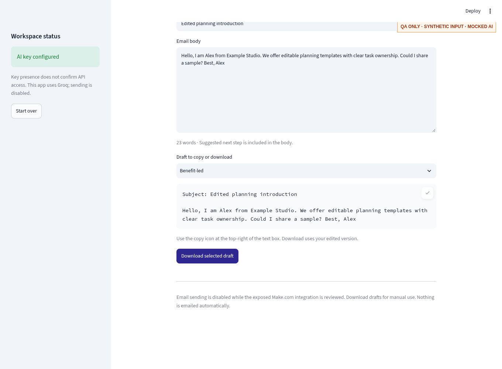

# QA report and evidence provenance

**Run date:** 13 October 2026

**Scope:** Fresh V1 finalization on `main`; no V2 source/test files copied or merged.

**Machine-readable record:** `qa_results.json`.

## Verified locally

| Check | Result | What it establishes |
|---|---|---|
| Python 3.12.14 test suite | 25 executed, 25 passed, 0 failed | Unit and Streamlit AppTest behavior with synthetic/mocked AI |
| Fresh Python 3.12 environment | requirements installed; 25 tests passed; pip check passed | Two-dependency manifest reproduces setup without Google SDK/V2 source |
| Python 3.14.8 suite | 25 executed, 25 passed, 0 failed | Additional compatibility evidence; 3.12 remains the recommended deployment |
| Real SDK + mocked HTTP | Success, 503 recovery and exhaustion checks passed | SDK wire format and at most two calls; no actual external API success |
| Browser startup without key | Passed | Real Streamlit app renders, form stays available, generation disabled |
| Browser generation/edit/export | Passed using an isolated mocked launcher | UI request flow, edited subject, clipboard and downloaded text |
| Mobile browser layout | Passed at 390-pixel viewport; no document horizontal overflow | Basic narrow-screen form check, not every browser/device |
| One-page idea PDF | Exactly one page generated | Submission-ready formatting of proposal content |
| Sending path | No send button, webhook call or active webhook literal | Delivery is disabled; no messages sent |

The tests initially exposed a selector callback that accessed session state after
context clearing. It was fixed by capturing immutable draft labels; the full suite
then passed. The final test run includes that fix.

Coverage includes required/oversized/typed fields, tone/length choices, safe missing
secrets, three-strategy JSON, subject/body/CTA consistency, duplicate drafts, unsupported
numbers, error categories, secret-free logs, interrupted/malformed responses, edits,
export formatting, failed replacements and session reset.

## Not verified or not performed

- **Live AI generation:** not run. No Groq/Gemini key is present in this workspace.
  A configured key in another Cloud app is not available to local execution.
- **Public deployment:** not established. The supplied public URL could not be reached
  from this machine; that does not prove the site is down. No app was deleted and no manual Cloud deployment action was performed.
- **Make.com delivery:** disabled and not tested. The old scenario is outside the repo.
- **Official tool-category compliance:** unconfirmed; exact category definitions unavailable.
- **Notion/posts/video:** files prepared; no external publication or actual recording performed.
- **Publication:** main publication approved by the owner. Check the final commit/push receipt in repository history and the publication hand-off. Live deployment remains unverified.

## Screenshot provenance

The screenshots are local QA evidence, not public-app or live-AI evidence. Labels are
embedded visibly in each image to prevent accidental misrepresentation.

### Real local interface, no API request

`01_Local_Form.png` shows the actual finalized source running without a key. It proves
local UI rendering only; the key is not invented or displayed.

### Isolated mocked response for review/export QA

`02_Mocked_Review.png` and `03_Mocked_Export.png` use synthetic Alex/Example Studio
inputs and deterministic mocked drafts from the test fixture. The QA launcher is
outside the repository and does not make API calls. A real browser copied the edited
text and downloaded a file whose content was checked. No inbox or webhook was used.
Replace these with real-generation screenshots before implying live functionality.

## Owner-run final acceptance check after approval

1. Publish approved main changes and confirm the target Cloud app uses main/app.py/Python 3.12.
2. Confirm a real Groq key securely; do not show the Secrets page in evidence.
3. Generate once with nonconfidential sample input. Check all three strategies and review facts.
4. Edit a subject/body, copy it, download and compare the actual file.
5. Record actual runtime/date/result and capture screenshots/video with visible public URL.
6. Check public access in a signed-out browser and verify reviewer links.
7. Resolve category eligibility before counting disabled automation or unverified tools.

Do not convert any mocked or pending result into a passed live check without the corresponding evidence.
